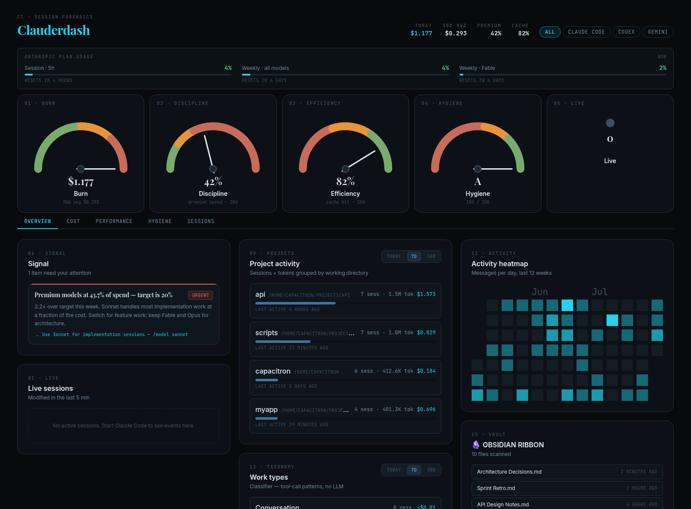

# Clauderdash

Local observability for Claude Code. Reads the data Claude Code already writes to your disk — no agents, no cloud, no account required.



## What it shows

| # | Panel | What it answers |
|---|-------|-----------------|
| 01 | **Burn** | How much am I spending per day? |
| 02 | **Discipline** | What % of my token spend is Opus? |
| 03 | **Efficiency** | What is my prompt cache hit rate? |
| 04 | **Hygiene** | How many sessions ended badly? |
| 05 | **Live** | How many sessions are running right now? |
| 06 | **System** | CPU / RAM / disk at a glance |
| 07 | **Token usage** | Input / output / cache-read / cache-create by day |
| 08 | **Tool latency** | p50 / p95 / max / error-rate per tool |
| 09 | **MCP drill-down** | Per-server and per-tool performance |
| 10 | **Session outcomes** | errored / rate_limited / truncated / unfinished / ok |
| 11 | **Cache efficiency** | Hit rate trend, target ≥ 70% |
| 12 | **Skills** | Slash-command activations + tokens per run |
| 13 | **Model mix** | Opus / Sonnet / Haiku % split |
| 14 | **Project activity** | Sessions grouped by working directory |
| 15 | **Obsidian ribbon** | Last 10 touched notes in your vault |
| 16 | **Suggestion box** | Weekly AI-generated forensic recommendations (opt-in) |

Runs entirely on your machine at `127.0.0.1:7777`. No cloud sync. One SQLite file.

## Requirements

- Linux with **systemd** (Arch, Ubuntu 22+, Fedora 38+, etc.)
- Python 3.11+
- Node 18+
- [Claude Code](https://claude.ai/code) installed and used at least once (so session data exists)

> macOS: systemd service won't apply. Backend and frontend run fine manually — skip the service steps and run `./scripts/dev.sh` instead.

## Install

```bash
git clone https://github.com/capacitron/clauderdash.git
cd clauderdash
./install.sh
```

What `install.sh` does:

1. Creates a Python venv and installs FastAPI + uvicorn + watchdog
2. Builds the React / Vite / Tailwind frontend
3. Adds `cc.local → 127.0.0.1` to `/etc/hosts` (requires sudo once)
4. Installs a systemd user service and enables it on login
5. Waits until the server responds on `127.0.0.1:7777`

Open `http://localhost:7777` (or `http://cc.local:7777`) when it finishes.

### Fixture mode

No real data yet? Seed 50 synthetic sessions so every panel renders immediately:

```bash
CLAUDE_DASHBOARD_DEV_MODE=1 ./install.sh
```

## Enable OTEL (recommended)

Without OTEL the panels still work from JSONL logs. With it you get real-time streaming plus event types that are not in JSONL (compaction, hook execution, API errors).

```bash
./scripts/setup-otel.sh
# Quit and restart Claude Code.
```

The script backs up `~/.claude/settings.json` before writing and never overwrites existing keys.

## Verify everything is working

```bash
./scripts/doctor.sh
```

Exit 0 + all green rows = good.

## URLs

| | URL |
|---|---|
| Dashboard | http://localhost:7777 |
| Alt | http://cc.local:7777 |
| Alt | http://claude.local:7777 |
| API docs | http://localhost:7777/api/docs |
| Health | http://localhost:7777/healthz |

## Service control

```bash
systemctl --user status claude-dashboard
systemctl --user restart claude-dashboard
systemctl --user stop claude-dashboard
journalctl --user -u claude-dashboard -f
```

## Configuration

All settings are environment variables. Set them before running `install.sh` or export them in your shell before starting the service.

| Variable | Default | Description |
|---|---|---|
| `CLAUDE_PROJECTS_DIR` | `~/.claude/projects` | Claude Code session data directory |
| `CLAUDE_DASHBOARD_DATA_DIR` | `<repo>/data` | Where `dashboard.db` is stored |
| `CLAUDE_DASHBOARD_HOST` | `127.0.0.1` | Bind address |
| `CLAUDE_DASHBOARD_PORT` | `7777` | Bind port |
| `CLAUDE_DASHBOARD_OBSIDIAN_DIR` | `~/Documents/ObsidianVault` | Obsidian vault path for panel 15 |
| `CLAUDE_DASHBOARD_OBSIDIAN_MAX_FILES` | `5000` | Max files to stat during vault scan |
| `CLAUDE_DASHBOARD_DEV_MODE` | `0` | Set to `1` to seed fixture data |

### Project tags (optional)

`config.py` has a `PROJECT_TAG_RULES` list that maps working-directory prefixes to short labels. Edit it to group your projects in the activity and suggestion panels:

```python
# backend/app/config.py
PROJECT_TAG_RULES: list[tuple[str, str]] = [
    (str(HOME / "projects" / "myapp"), "myapp"),
    (str(HOME / "work" / "client-x"), "client-x"),
    (str(HOME), "personal"),
]
```

## Dev mode (hot reload)

```bash
./scripts/dev.sh
# Frontend: http://localhost:5173 (Vite HMR, proxies /api → :7777)
# Backend:  http://localhost:7777 (uvicorn --reload)
```

Stops the systemd service while running. Restart when done:

```bash
systemctl --user start claude-dashboard
```

## Suggestion box (opt-in, outbound network)

A weekly forensic panel. Runs `claude -p --model haiku` against six aggregate SQL queries and writes up to 5 recommendations to `data/recommendations.json`.

**This is the one exception to the no-outbound-network rule.** Everything else is local-only.

### Privacy guarantees

- Six allowlisted aggregate queries — no ad-hoc SQL path
- `input_preview` column structurally excluded from all queries (confirmed to contain API key fragments in session data)
- `error_preview` truncated to 80 chars
- No session IDs, no raw prompts or responses sent
- Hard cost cap: `--max-budget-usd 0.15`. Typical run: $0.05–0.10
- Every run appended to `data/generator.log` (tokens + cost per line)

### Try it manually first

```bash
cd /path/to/clauderdash
./backend/.venv/bin/python scripts/generate_recommendations.py --dry-run  # prints SQL results, no API call
./backend/.venv/bin/python scripts/generate_recommendations.py            # real run
cat data/recommendations.json | python3 -m json.tool
```

Refresh the dashboard — the SUGGESTIONS panel populates.

### Drift engine (local, no network)

The same run also performs **intent-vs-behavior drift detection**, computed entirely **locally** — no part of it is sent to any model.

It reads a `## Measurable Targets (Drift-Checked)` pipe table from your `CLAUDE.md` (override path with `CLAUDE_DRIFT_RULES_FILE`), runs each declared target's read-only SQL against `dashboard.db`, and compares actual telemetry to the threshold *you* set in the table. Any breach becomes a high-signal rec (with `rule_ref` / `expected` / `actual` / `drift_score`) prepended to `recommendations.json` and shown with a **RULE DRIFT** badge on the panel.

Declare a target by adding a row:

```markdown
## Measurable Targets (Drift-Checked)

| id | Target | Window | Threshold |
|----|--------|--------|-----------|
| opus_share | Opus share of total tokens | 30d | < 20% |
| cache_hit  | Prompt cache hit rate      | 30d | >= 70% |
```

A target is checked only if its `id` exists in **both** the table and `RULE_CHECKS` in `generate_recommendations.py` (built-in ids: `opus_share`, `cache_hit`, `fail_rate`, `repeat_err`, `web_err`). The table is authoritative for thresholds — tune freely without touching code. `--dry-run` prints all drift findings to stderr (nothing sent anywhere), so you can audit before enabling the timer.

> Note: this is a *deterministic numeric-rule* checker — it catches measurable threshold rules (Opus %, cache %, error rates), not prose rules. Drift uses zero outbound network; only the separate `claude -p` observation pass (above) reaches the API.

### Enable weekly timer (Sundays at 09:00)

```bash
PROJECT_DIR="$(pwd)"
sed "s|__PROJECT_DIR__|$PROJECT_DIR|g" \
    "$PROJECT_DIR/systemd/claude-dashboard-suggestions.service" \
    > "$HOME/.config/systemd/user/claude-dashboard-suggestions.service"
cp "$PROJECT_DIR/systemd/claude-dashboard-suggestions.timer" \
   "$HOME/.config/systemd/user/claude-dashboard-suggestions.timer"
systemctl --user daemon-reload
systemctl --user enable --now claude-dashboard-suggestions.timer
```

To disable:

```bash
systemctl --user disable --now claude-dashboard-suggestions.timer
```

## Architecture

```
Claude Code ─┬─ writes JSONL ──→ ~/.claude/projects/
             │
             └─ emits OTEL ───→ POST http://localhost:7777/v1/logs
                                      http://localhost:7777/v1/metrics

Clauderdash (FastAPI :7777)
   ├─ watcher: polls ~/.claude/projects every 2s, parses new lines
   ├─ OTEL receiver: /v1/logs + /v1/metrics
   ├─ SQLite WAL: sessions / messages / tool_calls / skills / otel_events
   └─ SPA: React + Vite + Tailwind + Recharts, served from /frontend/dist
```

## Layout

```
backend/
  app/
    main.py          FastAPI entry, SPA mount, startup hooks
    config.py        Paths, port, env overrides, model windows
    db.py            SQLite WAL helpers
    schema.sql       Tables + indexes
    ingest/
      jsonl.py       JSONL parser + incremental sync
      watcher.py     Background poll loop
      otel.py        OTLP/HTTP JSON receiver
      fixtures.py    DEV_MODE seeding
    api/
      panels.py      All panel endpoints + summary + doctor
      ranges.py      Range helpers + percentile
frontend/
  src/
    App.tsx          Dashboard grid + drawer
    components/      Panel, RangeToggle, RelativeTime, Skeleton
    panels/          One file per panel + SessionDrawer
    lib/             api + format utilities
scripts/
  dev.sh             Dev server launcher
  doctor.sh          Health check
  setup-otel.sh      Merge OTEL keys into ~/.claude/settings.json
  generate_recommendations.py  Suggestion box runner
systemd/
  claude-dashboard.service     User unit template
  claude-dashboard-suggestions.service + .timer
install.sh           Idempotent installer
```

## What this is not

- Not a mission control. No task queue, no human-in-the-loop, no agent orchestration.
- Not cloud sync. Delete `data/dashboard.db` to reset everything.
- Not a dollar cost estimator. Pricing varies by plan and account type.

## License

MIT
